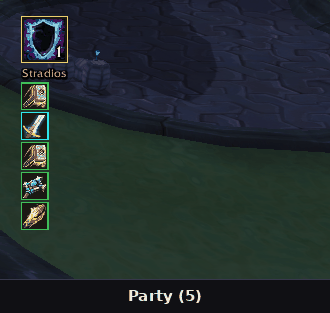

# Buff Me

**One-click smart buffing for every buffing class, on WoW 3.3.5a (Wrath of the Lich King) and WoW: Forever.**

Buff Me is a modern, themed buff manager. Press one button and it casts the next buff that someone in your group or raid needs. Keep pressing and everyone gets buffed. Paladin blessings are assigned automatically, with no setup panel to open.

It began as a remaster of the old PallyPower and grew into its own add-on that covers every class that can buff others.

## What it replaces

| Instead of... | Buff Me gives you |
| --- | --- |
| **PallyPower** (and its assignment panel) | Automatic Paladin blessing assignment that updates itself as the group changes |
| Separate buff macros and action-bar buttons | One button for the next missing buff |
| **Mage:** Arcane Intellect / Arcane Brilliance | Smart single or group choice |
| **Priest:** Fortitude / Prayer of Fortitude, Divine Spirit, Shadow Protection | Same one button |
| **Druid:** Mark of the Wild / Gift of the Wild, Thorns | Same one button |
| **Warrior:** Battle Shout / Commanding Shout | Same one button |
| **Death Knight:** Horn of Winter | Same one button |

## Features

- **One-click buffing.** Click, or scroll the mouse wheel over the button, to cast on the next player who needs it.
- **Paladin full auto-assignment.** Works out who gets Kings, Might, Wisdom or Sanctuary from the classes and specs in the group, and from which paladins are present and what they know. Every Buff Me client computes the same plan, so paladins don't need to coordinate.
- **Greater or normal, chosen for you.** Greater Blessings are used when a whole class shares the same blessing and the group is big enough (default: 4 or more). Smaller groups get single blessings. A Symbol of Kings is checked for.
- **Spec and role aware.** Reads specs from other Buff Me users, falls back to talent inspection, then to group roles, then to a class default. A tank is treated as a tank.
- **Per-player buttons.** A grid under the main button with one button per group member, showing the buff that player should get. Right-click one as a paladin to override that player's blessing.
- **Group simulation.** Preview the layout for 5, 10, 25, 40 and 60 players without being in a group.
- **Flexible layout.** Place the player grid below, above, left or right of the main button, with alignment, scale, icon size and player-button size settings.
- **Themes.** Auto-detects ElvUI and DragonUI, plus Dark, Retail, Classic, Light and Class colour themes, and an accent colour.
- **Minimap icon.** Left-click locks or unlocks, right-click opens settings, middle-click opens the paladin assignment grid.
- **Settings in Interface > AddOns.** General, Appearance, Layout & Simulation, Buffs, Greater Blessings (paladins only), and a How To tab.
- **Combat safe.** Layout changes made in combat are queued and applied when combat ends.

## Install

1. Delete the old `PallyPower` folder if you have it. The two would fight over the same job.
2. Copy the `BuffMe` folder into `World of Warcraft\Interface\AddOns\`.
3. Start the game. Right-click the minimap icon for settings; the **How To** tab explains everything.

No external libraries and nothing else to install.

## Controls

| Action | Result |
| --- | --- |
| Click the main button | Cast the next needed buff |
| Mouse wheel over the button | Same, one cast per notch |
| Shift / Ctrl / Alt + click | A specific single buff on your target |
| Left-click minimap icon | Lock / unlock the button |
| Right-click minimap icon | Open settings |
| Middle-click minimap icon | Paladin assignment grid |
| Right-click a player button (paladin) | Choose that player's blessing |

A key binding is available under *Esc > Key Bindings > Buff Me*, or use the macro `/click BuffMeButton`.

### Paladin modifier defaults

| Modifier + click | Blessing |
| --- | --- |
| Shift | Kings |
| Ctrl | Might |
| Alt | Wisdom |
| Ctrl + Shift | Sanctuary |

These can be changed in the settings.

### Slash commands

`/bm` opens settings. Also: `/bm lock`, `/bm unlock`, `/bm grid`, `/bm sim [size]`, `/bm reset`, `/bm plan`, `/bm help`.

## Compatibility

- **Client:** WoW 3.3.5a (Interface 30300, tested on Warmane) and the WoW: Forever client (Interface 16001, via `BuffMe_Camelot.toc`). One code base; `Compat.lua` is the only file that knows the clients differ, and it detects features instead of version numbers, so a patch that moves an API will not silently break the add-on.
- **Forever beta notes:** the client does not read SavedVariables back yet, so settings reset each login. When the client hides aura data (secret values), Buff Me stops suggesting buffs instead of guessing. Spec detection uses the specialization API; other players' talents are not inspected, so roles come from the group's role assignments.
- **UI add-ons:** ElvUI and DragonUI are optional dependencies and are detected automatically. Other UIs use the dark theme.
- **Classes:** Paladin (full auto-assignment), Priest, Druid, Mage, Warrior, Death Knight.

## Limitations

- The client allows one cast per click, so Buff Me picks the next target after each cast and you click again (or use the mouse wheel or a key binding).
- A paladin has one blessing per target; a new blessing replaces the previous one. The assignment is built around that.
- DragonUI has no public theming API, so its detection uses the Retail look as a best guess.

## Author

Stradios
